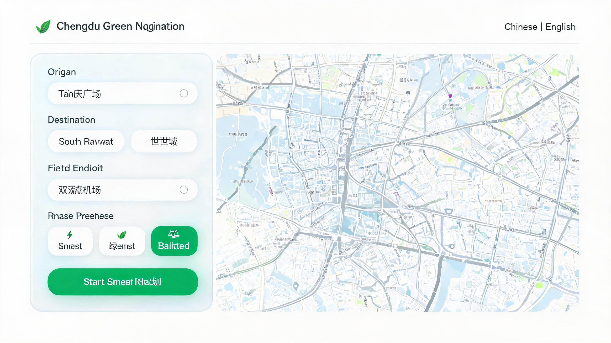

# Rongcheng Jingtu · Health-Aware Route Navigation System for Air Quality

> A dual-objective (distance × air quality) multi-destination route optimisation system based on **state-compressed dynamic programming (SCDP)**, offering interactive health-aware navigation in the browser together with the complete experiment scripts, raw data and random seeds needed to reproduce every result in the paper with a single command.



## Table of Contents

- [1. Project Overview](#1-project-overview)
- [2. Key Features](#2-key-features)
- [3. System Architecture](#3-system-architecture)
- [4. Algorithm Design](#4-algorithm-design)
- [5. Repository Structure](#5-repository-structure)
- [6. Quick Start](#6-quick-start)
- [7. Configuration](#7-configuration)
- [8. API Documentation](#8-api-documentation)
- [9. Experimental Data and Reproducibility](#9-experimental-data-and-reproducibility)
- [10. Data Availability Statement](#10-data-availability-statement)
- [11. Production Deployment](#11-production-deployment)
- [12. Frequently Asked Questions](#12-frequently-asked-questions)
- [13. Citation](#13-citation)
- [14. License and Acknowledgements](#14-license-and-acknowledgements)

---

## 1. Project Overview

**Rongcheng Jingtu (蓉城净途)** is an intelligent health-aware navigation system for the city of Chengdu. Conventional navigation optimises only "shortest distance / fastest time", ignoring the health impact of air-pollution exposure along the route on people with sensitive respiratory systems. This project introduces the **AQI (Air Quality Index)** into the path cost function, models multi-destination route planning as a **dual-objective travelling salesman problem (TSP)**, and solves it to exact optimality with state-compressed dynamic programming; the resulting health-aware routes, health scores and protective recommendations are then presented on a web map.

**Core contributions**

1. **Dual-objective cost modelling**: distance and AQI are normalised and then fused with weights (`green` mode applies an inverse normalisation to AQI), supporting three modes: shortest distance / greenest / balanced recommendation.
2. **Exact SCDP solver**: `O(n²·2ⁿ)` time and `O(n·2ⁿ)` space, returning the global optimum within milliseconds for n ≤ 15, outperforming Greedy and GA (see [experimental results](#9-experimental-data-and-reproducibility)).
3. **Optional C++ acceleration**: a pybind11-exported C++ TSP module; the top-level dispatcher automatically falls back to the Python DP / heuristic algorithms when the module is missing or the call fails, guaranteeing service availability.
4. **Fully reproducible**: all experiment scripts, raw JSON results, random seeds, paper tables and figures are shipped with the repository.

> The system provides both a Chinese (`index.html`) and an English (`index_en.html`) interface.

---

## 2. Key Features

| Module | Capability |
| --- | --- |
| Multi-destination planning | 1 origin + up to 7 destinations (`MAX_DESTINATIONS`), returning the optimal visiting order |
| Health cost optimisation | Distance × AQI dual-objective weighting; AQI obtained from the Open-Meteo real-time API |
| Three preferences | `shortest` (α=1, β=0) / `green` (α=0, β=1) / `balanced` (α=β=0.5, user-configurable) |
| Health assessment | 0–100 health score, mean AQI, pollution exposure index and per-stop AQI |
| Real-time navigation | GPS positioning, turn-by-turn prompts, remaining distance/time; dual HTTP and Socket.IO channels |
| Smart input | AMap input suggestions (restricted to Chengdu), auto-completion on selection |
| Bilingual interface | Separate entry points, complete localisation via vue-i18n |
| Engineering safeguards | Request-level logging with `request_id`, distance/AQI caching, parameter boundary validation, exception fallback |

---

## 3. System Architecture


```
Vue 3 frontend (AMap JS API 2.0)
        │  REST / Socket.IO
        ▼
Flask backend (app.py, routing + validation + logging)
        │
        ├── RoutePlanner (cost matrix, SCDP solving, caching)
        │     ├── build_cost_matrix  ← distance matrix (AMap driving route planning)
        │     │                       ← AQI list (Open-Meteo)
        │     └── solve_tsp          ← C++ _core (n ≤ 10)
        │                               ← Python SCDP (n ≤ 8)
        │                               ← heuristic (n > 8)
        └── AMapClient (geocoding / route distance / traffic)
```

**Five-stage processing pipeline**


Tech stack: Vue 3 + Vite + AMap JS API; Flask + Flask-SocketIO + Eventlet; C++17 + pybind11 + CMake; NumPy/SciPy/Matplotlib (experiments).

---

## 4. Algorithm Design

### 4.1 Dual-objective cost matrix

Let the node set be `V = {0, 1, …, n-1}`, `d_ij` the driving distance from i to j (metres) and `a_j` the AQI at node j. Distances are normalised by the maximum distance and AQI values by the maximum AQI (`green` mode instead uses a reversed Min-Max normalisation so that lower AQI yields a smaller cost). The edge cost is:

```
balanced : C_ij = α · (d_ij / d_max) + β · (a_j / a_max)          (usually α + β = 1)
shortest : C_ij = d_ij / d_max
green    : C_ij = (a_max - a_j) / (a_max - a_min)                 (distance weight set to 0)
```

### 4.2 State-compressed dynamic programming (SCDP)

`dp[mask][j]` denotes the minimum accumulated cost of having visited the set `mask` and currently standing at j:

```
dp[1 << 0][0] = 0
dp[mask ∪ {k}][k] = min{ dp[mask][j] + C_jk }        (k ∉ mask)
answer = min_j dp[(1<<n)-1][j] + C_j0               (return to the origin, closing the tour)
```

- Time complexity `O(n²·2ⁿ)`, space `O(n·2ⁿ)`;
- The optimal order is reconstructed by backtracking through the `parent` array;
- A **fixed origin–destination** variant (`solve_tsp_fixed_end`, exact for m ≤ 7 intermediate nodes) is also provided for scenarios where "the end point is fixed and only the order of waypoints is optimised".

### 4.3 Solver dispatch and fallback chain

| Condition | Solver | Note |
| --- | --- | --- |
| n ≤ 10 and `_core` available | C++ SCDP | Optimal; falls back on failure |
| n ≤ 8 | Python SCDP | Pure-Python optimal solution |
| n > 8 (and no C++) | Heuristic (nearest neighbour + 2-opt) | Approximate, bounded response time |
| Fixed end point, m ≤ 7 | Python DP (fixed end points) | Exact |
| Fixed end point, m > 7 | Heuristic | Approximate |

The web service is bounded by `MAX_DESTINATIONS = 7` (8 nodes including the origin), so the online path always uses the exact solution; the experiment scripts independently generate instances with n = 5–15 for performance evaluation.

> Path convention: the Python implementation and the experiment scripts solve a **closed-loop TSP** (returning to the origin), whereas the C++ module (`cpp/src/TSP.cpp`) solves an open path (not forced to return to the origin). The web layer additionally accounts for the "destination→origin" cost when returning results; both conventions are annotated separately in the reports.

---

## 5. Repository Structure

```
rongcheng-jingtu/
├── python/                      # Flask backend
│   ├── app.py                   # Application entry point, routes, Socket.IO
│   ├── route_planner.py         # Cost matrix construction, SCDP, caching, health score
│   ├── api_client.py            # AMap Web Service wrapper (geocoding / driving distance / traffic)
│   ├── utils.py                 # estimate_aqi wrapper
│   ├── fetch_aqi_openmeteo.py   # Open-Meteo real-time AQI retrieval
│   ├── main.py                  # Command-line planning entry point (no web service required)
│   ├── config.example.py        # Configuration template (copy to config.py)
│   └── requirements.txt
├── frontend/                    # Vue 3 + Vite frontend
│   ├── src/
│   │   ├── components/          # Page components such as HomeView
│   │   ├── composables/         # useAMapStrict map wrapper
│   │   └── locales/             # zh.js / en.js
│   ├── index.html               # Chinese entry point
│   ├── index_en.html            # English entry point
│   ├── .env.example             # Frontend environment variable template
│   └── package.json
├── cpp/                         # C++ TSP acceleration module
│   ├── include/TSP.h
│   ├── src/TSP.cpp
│   ├── bindings.cpp             # pybind11 bindings
│   └── CMakeLists.txt
├── experiments/                 # Experiment and reproducibility assets
│   ├── scripts/                 # Benchmark, table-generation and plotting scripts
│   ├── data/                    # Raw result JSON, hardware environment
│   ├── results/                 # Generated tables, logs, path-detail documents
│   ├── docs/                    # Experiment reports (Chinese/English), discussion
│   └── requirements.txt
├── figures/                     # Paper figures (UI screenshots, sensitivity analysis)
├── docs/diagrams/               # Mermaid sources and exported images (architecture/pipeline)
├── diagrams/                    # Interactive flow charts (HTML, open directly in a browser)
├── start.bat                    # One-click launcher for Windows
├── LICENSE
└── README.md
```

---

## 6. Quick Start

### 6.1 Requirements

| Dependency | Version |
| --- | --- |
| Python | 3.9 (matches the ABI of the pre-built C++ module; other versions require recompilation) |
| Node.js | ≥ 20.19 (required by Vite 8) |
| CMake | ≥ 3.10 (only needed to build the C++ module) |
| AMap | Web Service Key + JS API security key ([console](https://console.amap.com/)) |

### 6.2 Backend

```bash
cd python
python -m venv venv
# Windows: venv\Scripts\activate ; Linux/macOS: source venv/bin/activate
pip install -r requirements.txt
copy config.example.py config.py      # Windows
# cp config.example.py config.py      # Linux / macOS
# Edit config.py and fill in AMAP_API_KEY
python app.py                          # http://localhost:5000
```

### 6.3 Frontend

```bash
cd frontend
npm install
copy .env.example .env                 # Windows
# cp .env.example .env                 # Linux / macOS
# Edit .env and fill in VITE_AMAP_SECURITY_CODE
npm run dev                            # http://localhost:3000
```

Chinese interface: <http://localhost:3000/index.html>; English interface: <http://localhost:3000/index_en.html>.

### 6.4 Building the C++ acceleration module (optional)

```bash
cd cpp
mkdir build && cd build
cmake ..
cmake --build . --config Release
```

The artifact `_core.pyd` (Windows) or `_core.so` (Linux) is emitted automatically into `python/`. If CMake cannot locate pybind11, set the environment variable before configuring:

```bash
pip install pybind11
# Windows PowerShell
$env:pybind11_DIR = python -c "import pybind11; print(pybind11.get_cmake_dir())"
# Linux / macOS
export pybind11_DIR=$(python -c "import pybind11; print(pybind11.get_cmake_dir())")
```

When the module is not compiled, the system automatically uses the Python SCDP implementation and functionality is unaffected.

### 6.5 Command-line planning (optional)

Validate the backend and the algorithm pipeline directly in a terminal without starting the web service:

```bash
cd python
python main.py "天府广场,宽窄巷子,武侯祠" --preference balanced
```

### 6.6 One-click launcher (Windows)

```bat
start.bat
```

---

## 7. Configuration

| Location | Variable | Description |
| --- | --- | --- |
| `python/config.py` | `AMAP_API_KEY` | AMap Web Service Key (backend geocoding / route planning) |
| `python/config.py` | `MAX_DESTINATIONS` | Maximum number of destinations, default 7 |
| `python/config.py` | `DEFAULT_ALPHA` / `DEFAULT_BETA` | Default weights for `balanced` mode |
| `python/config.py` | `REQUEST_TIMEOUT` | AMap API timeout (seconds) |
| `frontend/.env` | `VITE_AMAP_SECURITY_CODE` | AMap JS API security key, injected into `window._AMapSecurityConfig` in `index.html` |
| Environment variable | `FLASK_PORT` | Backend port, default 5000 |
| Environment variable | `SECRET_KEY` | Flask session key (must be set in production) |

> ⚠️ `config.py` and `frontend/.env` are ignored by `.gitignore`; never commit real keys. If a key has ever appeared in a historical commit, **reset the key** in the console before making the repository public.

---

## 8. API Documentation

### `POST /api/plan` — route planning

Request (either of the two modes):

```json
{
  "destinations": ["天府广场", "成都东站", "环球中心"],
  "preference": "balanced",
  "alpha": 0.5,
  "beta": 0.5
}
```

```json
{
  "destinations": ["起点", "A", "B"],
  "coordinates": [[104.06, 30.67], [104.10, 30.65], [104.08, 30.60]],
  "preference": "green"
}
```

Response (excerpt):

```json
{
  "order": [0, 2, 1],
  "names": ["天府广场", "环球中心", "成都东站"],
  "route_stops": [{"index": 0, "name": "天府广场", "aqi": 46, "coordinate": [104.06, 30.67], "is_start": true}],
  "total_cost": 2.9607,
  "health_score": 96.5,
  "avg_aqi": 29.5,
  "aqi": [46, 32, 41],
  "distance": "88.08 km",
  "distance_km": 88.08,
  "preference": "balanced",
  "request_id": "a1b2c3d4"
}
```

Error codes: `400` invalid or out-of-range parameters; `500` service error (includes `type` and `message`).

### Navigation endpoints

| Method | Path | Description |
| --- | --- | --- |
| POST | `/api/navigate` | Start navigation (`route_id` + `current_location [lng, lat]`) |
| POST | `/api/navigate/update` | Update position, returning the next turn and remaining distance |
| POST | `/api/navigate/cancel` | End navigation |
| GET | `/api/health` | Health check |

### Socket.IO events

| Event | Direction | Payload |
| --- | --- | --- |
| `start_navigation` | client → server | `{ route_id, current_location }` |
| `update_position` | client → server | `{ route_id, current_location }` |
| `stop_navigation` | client → server | `{ route_id }` |
| `navigation_started` / `navigation_updated` / `navigation_stopped` | server → client | Status, position, next turn, remaining distance and time |

---

## 9. Experimental Data and Reproducibility

### 9.1 Data assets (`experiments/data/`)

| File | Content | Structure |
| --- | --- | --- |
| `raw_results.json` | Raw results of the main experiment (all metrics of Tables 1–7) | `{hardware, table1_2, table3, table4, table5, table6, table7}` |
| `extra_algos_results.json` | Per-scale results for the extended algorithms (Greedy/GA/SCDP/…) | Keys are node counts `5/8/10/12` |
| `path_details.json` | Optimal path details for each scale (node sequence, cost) | Keys are node counts `5/8/10/12/15` |
| `weight_sensitivity_data.json` | Data from the α-sweep sensitivity experiment | `{alpha_values, distances, aqi_exposures, comprehensive_costs}` |
| `weight_sensitivity_data_zh.json` | Chinese-language sensitivity data (with routes) | As above + `beta_values, paths` |
| `hw_env.txt` | Snapshot of the experimental hardware and software environment | Plain text |

Results and tables are located in `experiments/results/`:

| File | Content |
| --- | --- |
| `paper_tables.tex` / `table1_2.tex` | Paper booktabs-style tables (English LaTeX) |
| `paper_tables_zh.md` / `paper_tables_zh.tex` | Chinese-language tables |
| `Discussion.txt` | Key discussion points on the results |
| `benchmark_output*.txt` | Benchmark run logs (early/latest) |
| `生成地名版本的路径表.docx` | Appendix: path-detail table after place-name mapping |

Figures: `figures/` (Chinese and English interface screenshots, Figure 4 weight-sensitivity analysis as PNG/PDF); architecture and pipeline: `docs/diagrams/` (Mermaid sources `.mmd` + exported PNG); `diagrams/` contains interactive flow charts that can be opened directly in a browser.

### 9.2 Random seeds and hyper-parameters (critical for reproduction)

| Parameter | Value | Location |
| --- | --- | --- |
| Global seed `random.seed` / `np.random.seed` | `42` | `run_sci_benchmark.py`, `run_extra_algos.py` |
| Per-scale instance seed `SEED_MAP` | `{5: 47, 8: 361, 10: 52, 12: 54, 15: 57}` | `run_sci_benchmark.py` |
| Independent repetitions `N_REPS` / `N_RUNS` | `30` (the deterministic SCDP algorithm is run once) | Same as above |
| GA parameters | population 200, 500 iterations, crossover 0.8, mutation 0.1 | Same as above |
| Normalisation | Min-Max, diagonal excluded from the distance matrix | `build_cost_matrix` |
| Significance test | Wilcoxon signed-rank test, `p < 0.05` | Experiment report |

### 9.3 One-command reproduction

```bash
pip install -r experiments/requirements.txt

python experiments/scripts/run_sci_benchmark.py     # Main experiment → data/raw_results.json + results/table1_2.tex
python experiments/scripts/run_extra_algos.py       # Extended algorithms → data/extra_algos_results.json
python experiments/scripts/gen_path_detail.py       # Path details → data/path_details.json
python experiments/scripts/generate_paper_tables.py # English tables → results/paper_tables.tex
python experiments/scripts/generate_paper_tables_zh.py # Chinese tables → results/paper_tables_zh.md
python experiments/scripts/plot_sensitivity.py      # Figure 4 → figures/Fig4_Weight_Sensitivity.png
python experiments/scripts/verify_results.py        # Result consistency check
```

> The full experiment includes repeated GA runs and therefore takes a long time; all output paths are relative to the repository root, so no script modification is required.
> Detailed experiment notes are available in [`experiments/README.md`](experiments/README.md) and [`experiments/docs/SCI_Experiments_CN.md`](experiments/docs/SCI_Experiments_CN.md).

### 9.4 Main results (excerpt)

Composite cost `C = 0.5D + 0.5AQI` (n = 12):

| Algorithm | Distance (km) | Composite cost | Optimality gap |
| --- | ---: | ---: | ---: |
| Greedy | 139.51 | 6.1235 | 8.10% |
| GA | 119.43 | 5.7152 | 0.89% |
| **SCDP** | **117.16** | **5.6647** | **0.00%** |

Health-aware navigation vs the conventional shortest route (n = 8):

| Route | Distance (km) | Pollution exposure | Health score |
| --- | ---: | ---: | ---: |
| Conventional shortest | 78.35 | 255.32 | 94.95 |
| AQI-optimised | 88.08 | 235.56 | 96.47 |
| Change | +12.4% | **−7.74%** | **+1.52** |

Computation time: SCDP < 38 ms for n ≤ 12; about 465 ms for n = 15, still meeting interactive navigation requirements. Full data are available in `experiments/data/raw_results.json`.

---

## 10. Data Availability Statement

The following text can be used directly when the submission system requests a "data availability" statement:

> **Data availability.** All source code, experiment scripts, raw result files, random seeds and hyper-parameter settings supporting the findings of this study are openly available in the *Rongcheng Jingtu* repository at `https://github.com/RUO-MO/rongcheng-jingtu`. The archived snapshot analysed in this study is available at <https://doi.org/10.5281/zenodo.23939568> (version DOI); the concept DOI covering all versions is <https://doi.org/10.5281/zenodo.23939567>. No restricted or proprietary data were used. Air quality observations were retrieved from the Open-Meteo Air Quality API (<https://open-meteo.com/>); road-network distances were obtained via the AMap Web Service API under its standard terms of use.

The dataset has been archived: GitHub Release `v1.0.0` was automatically harvested by Zenodo, with version DOI `10.5281/zenodo.23939568` and concept DOI `10.5281/zenodo.23939567`. On the submission page, set *Link to data repository* to `https://doi.org/10.5281/zenodo.23939568`, choose **Zenodo** as *Repository name*, and **Original data** as *Source of data*.

The [`.zenodo.json`](.zenodo.json) and [`CITATION.cff`](CITATION.cff) files at the repository root already contain the final author list and DOI. Every subsequent GitHub Release will be archived automatically by Zenodo with a new version DOI, while the concept DOI remains unchanged.

---

## 11. Production Deployment

Frontend build:

```bash
cd frontend && npm run build     # output in frontend/dist
```

Backend (4 Eventlet processes):

```bash
cd python
gunicorn -w 4 -k eventlet -b 127.0.0.1:5000 app:app
```

Key Nginx configuration:

```nginx
location /api/      { proxy_pass http://127.0.0.1:5000; }
location /socket.io/ {
    proxy_pass http://127.0.0.1:5000;
    proxy_http_version 1.1;
    proxy_set_header Upgrade $http_upgrade;
    proxy_set_header Connection "upgrade";
}
```

Production notes: set `SECRET_KEY`; restrict `CORS` / `cors_allowed_origins` to the actual domain; configure rate limiting and caching for the AMap APIs.

---

## 12. Frequently Asked Questions

| Symptom | Troubleshooting |
| --- | --- |
| Blank map / `INVALID_USER_SCODE` error | `frontend/.env` not filled in or Vite not restarted; the key belongs to a different account than the backend Key |
| Geocoding failure | Invalid `AMAP_API_KEY` in `python/config.py`, missing Web Service permission, or exhausted quota |
| `ImportError: _core` | The C++ module has not been compiled (harmless: Python is used automatically), or the Python version does not match the `.pyd` ABI |
| AQI always 100 / 50 | Open-Meteo unreachable, triggering the default value; check network connectivity and timeouts |
| Planning returns 400 | More than 7 destinations, coordinates not in `[lng, lat]` form, or `alpha/beta` not numeric |
| Vite reports a Node version error on startup | Upgrade to Node.js ≥ 20.19 |

---

## 13. Citation

```bibtex
@dataset{rongcheng_jingtu,
  title     = {Rongcheng Jingtu Multi-Destination Route Planning Dataset: Distance and Air-Quality Matrices, Optimal Routes, and Benchmark Results},
  author    = {Yan, Min and Ma, Rui and Yang, Yan and Luo, Zhangmin and He, Enyao and Huang, Suyuan},
  year      = {2026},
  publisher = {Zenodo},
  version   = {v1.0.0},
  doi       = {10.5281/zenodo.23939568},
  url       = {https://doi.org/10.5281/zenodo.23939568}
}
```

---

## 14. License and Acknowledgements

This project is released under the [MIT License](LICENSE). Air quality data are provided by [Open-Meteo](https://open-meteo.com/); map and road-network services are provided by the [AMap Open Platform](https://lbs.amap.com/); experimental figures were generated with NumPy / SciPy / Matplotlib.

Please report issues via GitHub Issues.
