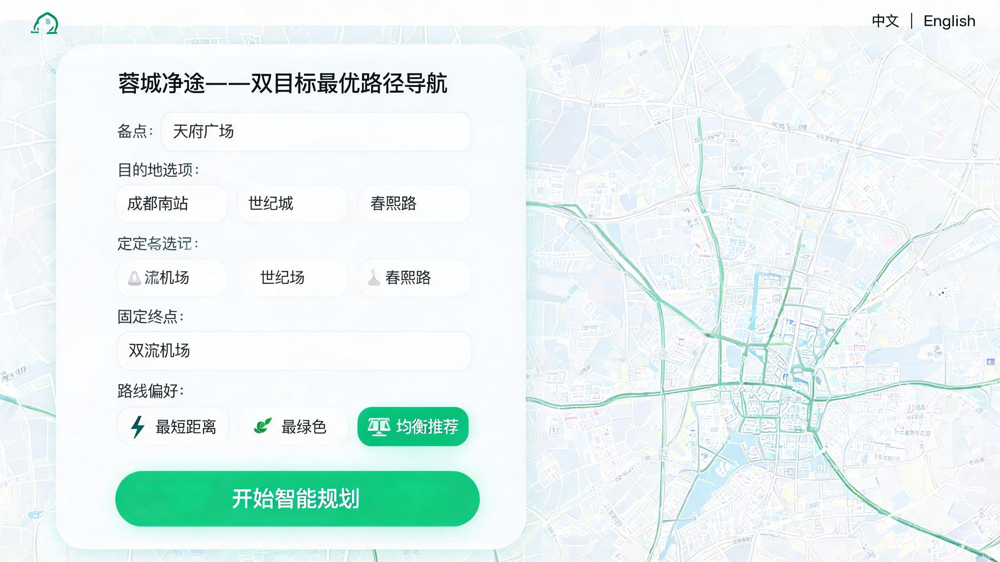
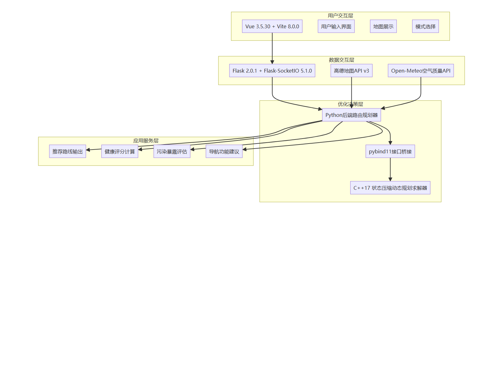
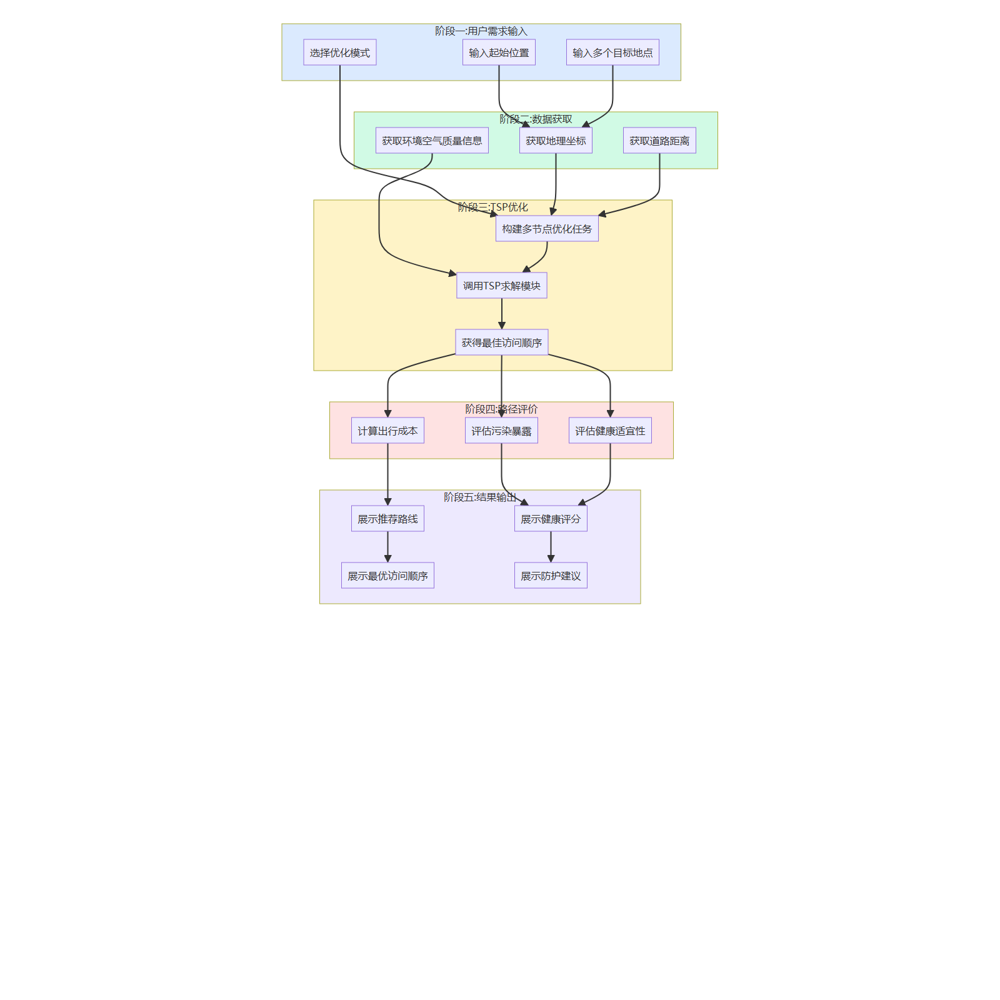

# 蓉城净途 · 面向空气质量的健康路径导航系统

> 基于**状态压缩动态规划（SCDP）**的双目标（距离 × 空气质量）多目的地路径优化系统，提供 Web 端交互式健康导航，并附带完整的实验脚本、原始数据与随机种子，可一键复现论文全部结果。



## 目录

- [1. 项目简介](#1-项目简介)
- [2. 核心特性](#2-核心特性)
- [3. 系统架构](#3-系统架构)
- [4. 算法设计](#4-算法设计)
- [5. 仓库结构](#5-仓库结构)
- [6. 快速开始](#6-快速开始)
- [7. 配置说明](#7-配置说明)
- [8. API 文档](#8-api-文档)
- [9. 实验数据与复现](#9-实验数据与复现)
- [10. 数据可用性声明（论文投稿用）](#10-数据可用性声明论文投稿用)
- [11. 生产部署](#11-生产部署)
- [12. 常见问题](#12-常见问题)
- [13. 引用](#13-引用)
- [14. 许可证与致谢](#14-许可证与致谢)

---

## 1. 项目简介

**蓉城净途**（Rongcheng Jingtu）是面向成都市的智能健康导航系统。传统导航只优化"距离最短/时间最快"，忽略了沿途空气污染暴露对呼吸道敏感人群的健康影响。本项目将 **AQI（空气质量指数）** 引入路径代价函数，把多目的地路径规划建模为**双目标旅行商问题（TSP）**，并用状态压缩动态规划求精确最优解，最终在 Web 地图上呈现健康路线、健康评分与防护建议。

**核心贡献**

1. **双目标代价建模**：距离与 AQI 归一化后加权融合（green 模式对 AQI 做反向归一化），支持最短距离 / 最绿色 / 均衡推荐三种模式。
2. **SCDP 精确求解器**：`O(n²·2ⁿ)` 时间、`O(n·2ⁿ)` 空间，在 n ≤ 15 的规模下毫秒级求全局最优，优于 Greedy 与 GA（见[实验结果](#9-实验数据与复现)）。
3. **可选的 C++ 加速**：pybind11 导出的 C++ TSP 模块，顶层调度在模块缺失或调用失败时自动回退到 Python DP / 启发式算法，保证服务可用性。
4. **完整可复现**：全部实验脚本、原始 JSON 结果、随机种子、论文表格与图件随仓库提供。

> 系统同时提供中文（`index.html`）与英文（`index_en.html`）两套界面。

---

## 2. 核心特性

| 模块 | 能力 |
| --- | --- |
| 多目的地规划 | 1 个起点 + 最多 7 个目的地（`MAX_DESTINATIONS`），输出最优访问顺序 |
| 健康代价优化 | 距离 × AQI 双目标加权；AQI 来自 Open-Meteo 实时接口 |
| 三种偏好 | `shortest`（α=1, β=0）/ `green`（α=0, β=1）/ `balanced`（α=β=0.5，可自定义） |
| 健康评估 | 输出 0–100 健康评分、平均 AQI、污染暴露指数与逐站 AQI |
| 实时导航 | GPS 定位、转向提示、剩余距离/时间；HTTP 与 Socket.IO 双通道 |
| 智能输入 | 高德输入提示（限定成都市），点击自动补全 |
| 双语界面 | 独立入口，vue-i18n 文案完整本地化 |
| 工程保障 | 请求级日志与 `request_id`、距离/AQI 缓存、参数边界校验、异常降级 |

---

## 3. 系统架构



```
Vue 3 前端（高德地图 JS API 2.0）
        │  REST / Socket.IO
        ▼
Flask 后端（app.py，路由 + 校验 + 日志）
        │
        ├── RoutePlanner（代价矩阵、SCDP 求解、缓存）
        │     ├── build_cost_matrix  ← 距离矩阵（高德驾车路径规划）
        │     │                       ← AQI 列表（Open-Meteo）
        │     └── solve_tsp          ← C++ _core（n ≤ 10）
        │                               ← Python SCDP（n ≤ 8）
        │                               ← 启发式（n > 8）
        └── AMapClient（地理编码 / 路径距离 / 路况）
```

**五阶段处理流程**



技术栈：Vue 3 + Vite + 高德 JS API；Flask + Flask-SocketIO + Eventlet；C++17 + pybind11 + CMake；NumPy/SciPy/Matplotlib（实验）。

---

## 4. 算法设计

### 4.1 双目标代价矩阵

设节点集合为 `V = {0, 1, …, n-1}`，`d_ij` 为 i→j 的驾车距离（米），`a_j` 为节点 j 的 AQI。距离按最大距离归一化、AQI 按最大 AQI 归一化（`green` 模式改用 Min-Max 反转，使低 AQI 获得更小代价）。边代价为：

```
balanced : C_ij = α · (d_ij / d_max) + β · (a_j / a_max)          （通常取 α + β = 1）
shortest : C_ij = d_ij / d_max
green    : C_ij = (a_max - a_j) / (a_max - a_min)                 （距离权重置 0）
```

### 4.2 状态压缩动态规划（SCDP）

以 `dp[mask][j]` 表示"已访问集合 mask、当前位于 j"的最小累计代价：

```
dp[1 << 0][0] = 0
dp[mask ∪ {k}][k] = min{ dp[mask][j] + C_jk }        (k ∉ mask)
answer = min_j dp[(1<<n)-1][j] + C_j0               （回到起点，构成闭环）
```

- 时间复杂度 `O(n²·2ⁿ)`，空间 `O(n·2ⁿ)`；
- 使用 `parent` 数组回溯最优顺序；
- 另有**固定起点—终点**变体（`solve_tsp_fixed_end`，中间节点 m ≤ 7 时精确求解），用于"终点固定、只优化途经点顺序"的场景。

### 4.3 求解器调度与降级链

| 条件 | 求解器 | 说明 |
| --- | --- | --- |
| n ≤ 10 且 `_core` 可用 | C++ SCDP | 最优；失败时回退 |
| n ≤ 8 | Python SCDP | 纯 Python 最优解 |
| n > 8（且无 C++） | 启发式（最近邻 + 2-opt） | 近似解，保证响应时间 |
| 固定终点、m ≤ 7 | Python DP（固定端点） | 精确 |
| 固定终点、m > 7 | 启发式 | 近似 |

Web 服务端受 `MAX_DESTINATIONS = 7` 限制（含起点共 8 节点），因此线上始终走精确解；实验脚本则独立生成 n = 5–15 的算例用于性能评估。

> 路径约定：Python 实现与实验脚本求解**闭环 TSP**（回到起点）；C++ 模块（`cpp/src/TSP.cpp`）求解开放路径（不强制回到起点），Web 端在返回结果时额外计入"终点→起点"的代价，两种口径在报告中已分别标注。

---

## 5. 仓库结构

```
rongcheng-jingtu/
├── python/                      # Flask 后端
│   ├── app.py                   # 应用入口、路由、Socket.IO
│   ├── route_planner.py         # 代价矩阵构建、SCDP、缓存、健康评分
│   ├── api_client.py            # 高德 Web 服务封装（地理编码/驾车距离/路况）
│   ├── utils.py                 # estimate_aqi 封装
│   ├── fetch_aqi_openmeteo.py   # Open-Meteo 实时 AQI 抓取
│   ├── config.example.py        # 配置模板（复制为 config.py）
│   └── requirements.txt
├── frontend/                    # Vue 3 + Vite 前端
│   ├── src/
│   │   ├── components/          # HomeView 等页面组件
│   │   ├── composables/         # useAMapStrict 地图封装
│   │   └── locales/             # zh.js / en.js
│   ├── index.html               # 中文入口
│   ├── index_en.html            # 英文入口
│   ├── .env.example             # 前端环境变量模板
│   └── package.json
├── cpp/                         # C++ TSP 加速模块
│   ├── include/TSP.h
│   ├── src/TSP.cpp
│   ├── bindings.cpp             # pybind11 绑定
│   └── CMakeLists.txt
├── experiments/                 # 实验与复现资产
│   ├── scripts/                 # 基准测试、制表、绘图脚本
│   ├── data/                    # 原始结果 JSON、硬件环境
│   ├── results/                 # 生成的表格、日志、路径明细文档
│   ├── docs/                    # 实验报告（中/英）、讨论
│   └── requirements.txt
├── figures/                     # 论文图件（界面截图、敏感性分析）
├── docs/diagrams/               # Mermaid 源文件与导出图（架构/流程）
├── diagrams/                    # 交互式流程图（HTML，可直接打开）
├── start.bat                    # Windows 一键启动
├── LICENSE
└── README.md
```

---

## 6. 快速开始

### 6.1 环境要求

| 依赖 | 版本 |
| --- | --- |
| Python | 3.9（与预编译 C++ 模块 ABI 一致；其他版本需自行重编译） |
| Node.js | ≥ 20.19（Vite 8 要求） |
| CMake | ≥ 3.10（仅编译 C++ 模块时需要） |
| 高德地图 | Web 服务 Key + JS API 安全密钥（[控制台](https://console.amap.com/)） |

### 6.2 后端

```bash
cd python
python -m venv venv
# Windows: venv\Scripts\activate ；Linux/macOS: source venv/bin/activate
pip install -r requirements.txt
copy config.example.py config.py      # Windows
# cp config.example.py config.py      # Linux / macOS
# 编辑 config.py，填入 AMAP_API_KEY 与 AMAP_SECURITY_CODE
python app.py                          # http://localhost:5000
```

### 6.3 前端

```bash
cd frontend
npm install
copy .env.example .env                 # Windows
# cp .env.example .env                 # Linux / macOS
# 编辑 .env，填入 VITE_AMAP_SECURITY_CODE
npm run dev                            # http://localhost:3000
```

中文界面：<http://localhost:3000/index.html>；英文界面：<http://localhost:3000/index_en.html>。

### 6.4 编译 C++ 加速模块（可选）

```bash
cd cpp
mkdir build && cd build
cmake ..
cmake --build . --config Release
```

产物 `_core.pyd`（Windows）或 `_core.so`（Linux）会自动输出到 `python/`。若 CMake 找不到 pybind11，可设置环境变量再配置：

```bash
pip install pybind11
# Windows PowerShell
$env:pybind11_DIR = python -c "import pybind11; print(pybind11.get_cmake_dir())"
# Linux / macOS
export pybind11_DIR=$(python -c "import pybind11; print(pybind11.get_cmake_dir())")
```

未编译时系统自动使用 Python SCDP，功能不受影响。

### 6.5 一键启动（Windows）

```bat
start.bat
```

---

## 7. 配置说明

| 位置 | 变量 | 说明 |
| --- | --- | --- |
| `python/config.py` | `AMAP_API_KEY` | 高德 Web 服务 Key（后端地理编码/路径规划） |
| `python/config.py` | `AMAP_SECURITY_CODE` | JS API 安全密钥（**前端**渲染时使用） |
| `python/config.py` | `MAX_DESTINATIONS` | 目的地上限，默认 7 |
| `python/config.py` | `DEFAULT_ALPHA` / `DEFAULT_BETA` | balanced 模式默认权重 |
| `python/config.py` | `REQUEST_TIMEOUT` | 高德接口超时（秒） |
| `frontend/.env` | `VITE_AMAP_SECURITY_CODE` | 注入到 `index.html` 的 `window._AMapSecurityConfig` |
| 环境变量 | `FLASK_PORT` | 后端端口，默认 5000 |
| 环境变量 | `SECRET_KEY` | Flask 会话密钥（生产环境务必设置） |

> ⚠️ `config.py`、`frontend/.env` 已被 `.gitignore` 忽略，请勿提交真实密钥。若密钥曾出现在历史提交中，请在控制台**重置密钥**后再公开仓库。

---

## 8. API 文档

### `POST /api/plan` — 路线规划

请求（两种模式任选其一）：

```json
{
  "destinations": ["天府广场", "成都东站", "环球中心"],
  "preference": "balanced",
  "alpha": 0.5,
  "beta": 0.5
}
```

```json
{
  "destinations": ["起点", "A", "B"],
  "coordinates": [[104.06, 30.67], [104.10, 30.65], [104.08, 30.60]],
  "preference": "green"
}
```

响应（节选）：

```json
{
  "order": [0, 2, 1],
  "names": ["天府广场", "环球中心", "成都东站"],
  "route_stops": [{"index": 0, "name": "天府广场", "aqi": 46, "coordinate": [104.06, 30.67], "is_start": true}],
  "total_cost": 2.9607,
  "health_score": 96.5,
  "avg_aqi": 29.5,
  "aqi": [46, 32, 41],
  "distance": "88.08 km",
  "distance_km": 88.08,
  "preference": "balanced",
  "request_id": "a1b2c3d4"
}
```

错误码：`400` 参数非法 / 超限；`500` 服务异常（含 `type`、`message`）。

### 导航接口

| 方法 | 路径 | 说明 |
| --- | --- | --- |
| POST | `/api/navigate` | 开始导航（`route_id` + `current_location [lng, lat]`） |
| POST | `/api/navigate/update` | 更新位置，返回下一转向与剩余里程 |
| POST | `/api/navigate/cancel` | 结束导航 |
| GET | `/api/health` | 健康检查 |

### Socket.IO 事件

| 事件 | 方向 | 载荷 |
| --- | --- | --- |
| `start_navigation` | 客户端 → 服务端 | `{ route_id, current_location }` |
| `update_position` | 客户端 → 服务端 | `{ route_id, current_location }` |
| `stop_navigation` | 客户端 → 服务端 | `{ route_id }` |
| `navigation_started` / `navigation_updated` / `navigation_stopped` | 服务端 → 客户端 | 状态、位置、下一转向、剩余距离与时间 |

---

## 9. 实验数据与复现

### 9.1 数据资产（`experiments/data/`）

| 文件 | 内容 | 结构 |
| --- | --- | --- |
| `raw_results.json` | 主实验原始结果（表 1–7 全部指标） | `{hardware, table1_2, table3, table4, table5, table6, table7}` |
| `extra_algos_results.json` | 扩展算法（Greedy/GA/SCDP/…）逐规模结果 | 键为节点数 `5/8/10/12` |
| `path_details.json` | 各规模最优路径明细（节点序列、代价） | 键为节点数 `5/8/10/12/15` |
| `weight_sensitivity_data.json` | α 扫描的敏感性实验数据 | `{alpha_values, distances, aqi_exposures, comprehensive_costs}` |
| `weight_sensitivity_data_zh.json` | 中文版敏感性数据（含路径） | 同上 + `beta_values, paths` |
| `hw_env.txt` | 实验硬件与软件环境快照 | 纯文本 |

结果与图表位于 `experiments/results/`：

| 文件 | 内容 |
| --- | --- |
| `paper_tables.tex` / `table1_2.tex` | 论文三线表（英文 LaTeX） |
| `paper_tables_zh.md` / `paper_tables_zh.tex` | 中文表格 |
| `Discussion.txt` | 结果讨论要点 |
| `benchmark_output*.txt` | 基准运行日志（早期/最新） |
| `生成地名版本的路径表.docx` | 附录：地名映射后的路径明细表 |

图件：`figures/`（中英文界面截图、图 4 权重敏感性分析 PNG/PDF）；架构与流程：`docs/diagrams/`（Mermaid 源文件 `.mmd` + 导出 PNG）；`diagrams/` 为可直接在浏览器打开的交互式流程图。

### 9.2 随机种子与超参数（复现关键）

| 参数 | 取值 | 位置 |
| --- | --- | --- |
| 全局种子 `random.seed` / `np.random.seed` | `42` | `run_sci_benchmark.py`、`run_extra_algos.py` |
| 各规模算例种子 `SEED_MAP` | `{5: 47, 8: 361, 10: 52, 12: 54, 15: 57}` | `run_sci_benchmark.py` |
| 独立重复次数 `N_REPS` / `N_RUNS` | `30`（SCDP 确定性算法运行 1 次） | 同上 |
| GA 参数 | 种群 200、迭代 500、交叉 0.8、变异 0.1 | 同上 |
| 归一化 | Min-Max，距离矩阵排除对角线 | `build_cost_matrix` |
| 显著性检验 | Wilcoxon 符号秩检验，`p < 0.05` | 实验报告 |

### 9.3 一键复现

```bash
pip install -r experiments/requirements.txt

python experiments/scripts/run_sci_benchmark.py     # 主实验 → data/raw_results.json + results/table1_2.tex
python experiments/scripts/run_extra_algos.py       # 扩展算法 → data/extra_algos_results.json
python experiments/scripts/gen_path_detail.py       # 路径明细 → data/path_details.json
python experiments/scripts/generate_paper_tables.py # 英文表格 → results/paper_tables.tex
python experiments/scripts/generate_paper_tables_zh.py # 中文表格 → results/paper_tables_zh.md
python experiments/scripts/plot_sensitivity.py      # 图 4 → figures/Fig4_Weight_Sensitivity.png
python experiments/scripts/verify_results.py        # 结果一致性校验
```

> 完整实验含 GA 多次重复，耗时较长；所有输出路径均相对仓库根目录，无需修改脚本。
> 实验说明详见 [`experiments/README.md`](experiments/README.md) 与 [`experiments/docs/SCI_Experiments_CN.md`](experiments/docs/SCI_Experiments_CN.md)。

### 9.4 主要结果（节选）

综合成本 `C = 0.5D + 0.5AQI`（n = 12）：

| 算法 | 距离 (km) | 综合成本 | 最优误差 |
| --- | ---: | ---: | ---: |
| Greedy | 139.51 | 6.1235 | 8.10% |
| GA | 119.43 | 5.7152 | 0.89% |
| **SCDP** | **117.16** | **5.6647** | **0.00%** |

健康导航 vs 传统最短路线（n = 8）：

| 路线 | 距离 (km) | 污染暴露 | 健康评分 |
| --- | ---: | ---: | ---: |
| 传统最短 | 78.35 | 255.32 | 94.95 |
| AQI 优化 | 88.08 | 235.56 | 96.47 |
| 变化 | +12.4% | **−7.74%** | **+1.52** |

计算耗时：n ≤ 12 时 SCDP < 38 ms；n = 15 时约 465 ms，仍满足交互式导航需求。完整数据见 `experiments/data/raw_results.json`。

---

## 10. 数据可用性声明（论文投稿用）

投稿系统要求填写"数据可用性"时可直接使用以下文本：

> **Data availability.** All source code, experiment scripts, raw result files, random seeds and hyper-parameter settings supporting the findings of this study are openly available in the *Rongcheng Jingtu* repository at `https://github.com/RUO-MO/-`. An archived snapshot with a DOI will be provided upon release. No restricted or proprietary data were used. Air quality observations were retrieved from the Open-Meteo Air Quality API (<https://open-meteo.com/>); road-network distances were obtained via the AMap Web Service API under its standard terms of use.

建议归档流程：GitHub 仓库 → Zenodo（或 figshare）Release → 获得 DOI → 回填投稿页的 *Data repository link*、*Repository name*（选 GitHub / Zenodo）、*Source of data*（选 **Original data**）。

---

## 11. 生产部署

前端构建：

```bash
cd frontend && npm run build     # 产物在 frontend/dist
```

后端（4 进程 Eventlet）：

```bash
cd python
gunicorn -w 4 -k eventlet -b 127.0.0.1:5000 app:app
```

Nginx 关键配置：

```nginx
location /api/      { proxy_pass http://127.0.0.1:5000; }
location /socket.io/ {
    proxy_pass http://127.0.0.1:5000;
    proxy_http_version 1.1;
    proxy_set_header Upgrade $http_upgrade;
    proxy_set_header Connection "upgrade";
}
```

生产环境注意：设置 `SECRET_KEY`；`CORS` / `cors_allowed_origins` 收敛到实际域名；为高德接口配置限流与缓存。

---

## 12. 常见问题

| 现象 | 排查 |
| --- | --- |
| 地图空白 / 报 `INVALID_USER_SCODE` | `frontend/.env` 未填写或未重启 Vite；密钥与后端 Key 不同账号 |
| 地理编码失败 | `python/config.py` 的 `AMAP_API_KEY` 无效、无 Web 服务权限或额度用尽 |
| `ImportError: _core` | 未编译 C++ 模块（可忽略，自动走 Python），或 Python 版本与 `.pyd` ABI 不符 |
| AQI 恒为 100 / 50 | Open-Meteo 不可达，触发默认值；检查网络与超时 |
| 规划返回 400 | 目的地超过 7 个、坐标格式非 `[lng, lat]`、`alpha/beta` 非数字 |
| Vite 启动报 Node 版本错误 | 升级至 Node.js ≥ 20.19 |

---

## 13. 引用

```bibtex
@software{rongcheng_jingtu,
  title  = {蓉城净途：面向空气质量的健康路径导航系统},
  author = {Rongcheng Jingtu Contributors},
  year   = {2026},
  note   = {State-compressed dynamic programming for bi-objective multi-destination routing},
  url    = {https://github.com/RUO-MO/-}
}
```

---

## 14. 许可证与致谢

本项目采用 [MIT License](LICENSE)。空气质量数据来自 [Open-Meteo](https://open-meteo.com/)，地图与路网服务由[高德开放平台](https://lbs.amap.com/)提供；实验图表由 NumPy / SciPy / Matplotlib 生成。

问题反馈请提交 GitHub Issues。
